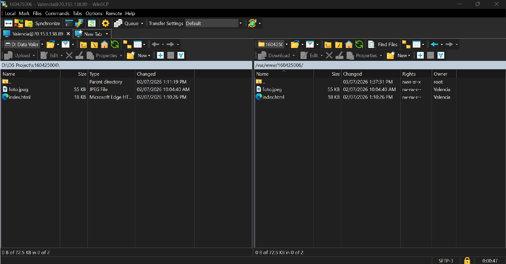
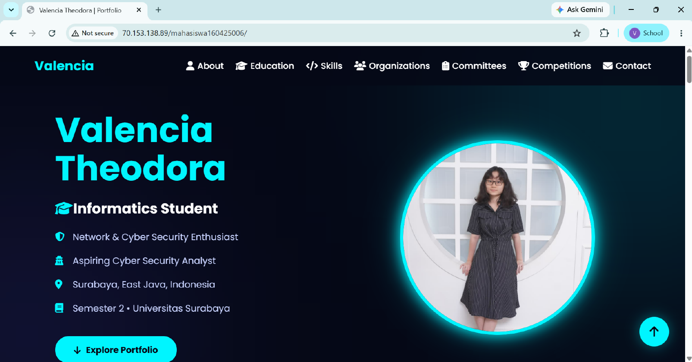
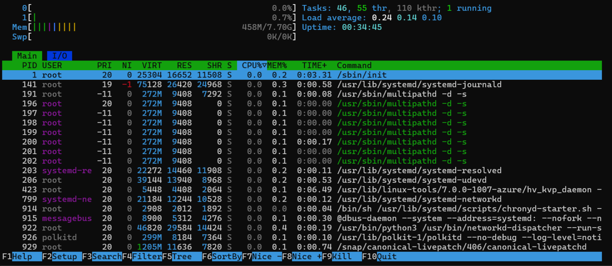
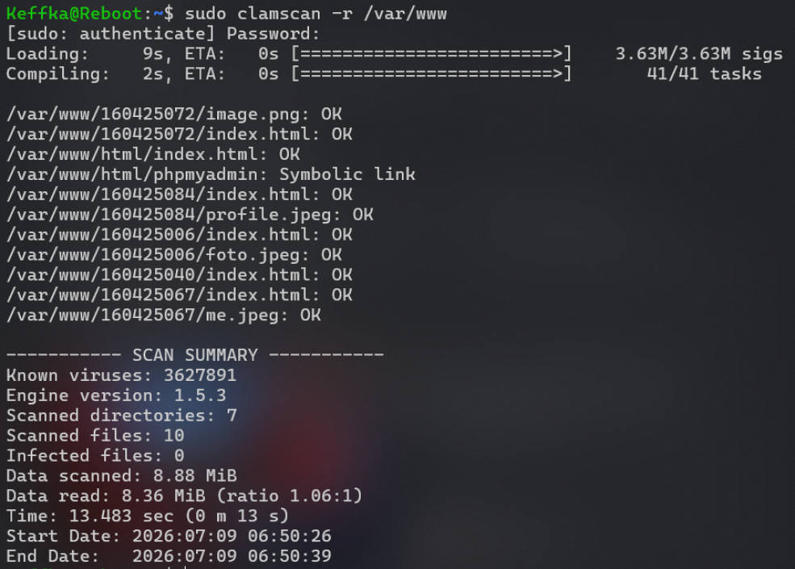

# Azure Ubuntu Server: Multi-User LAMP Stack, Virtual Host & Security Automation

A production-style Linux server administration and web hosting infrastructure project deployed on a **Microsoft Azure Virtual Private Server (VPS)** running **Ubuntu 26.04 LTS**. This project demonstrates end-to-end OS provisioning, role-based privilege separation, hardened LAMP stack deployment, custom Apache Virtual Host alias routing, SFTP publishing workflows, resource monitoring, and automated cron-based backup and antivirus pipelines.

---

## System Architecture & Specifications

- **Cloud Provider:** Microsoft Azure (Linux VPS)
- **Operating System:** Ubuntu 26.04 LTS (`GNU/Linux x86_64`, minimized server installation with LVM partitioning)
- **Web Server:** Apache HTTP Server `2.4.66` with custom Virtual Host (`reboot.id`)
- **Backend & Database:** PHP `8.5.4`, MariaDB `11.8.6`, and phpMyAdmin
- **Remote Access & File Transfer:** OpenSSH Server (Port `22`) and SFTP (CLI `sftp`, WinSCP, FileZilla)
- **Security & Maintenance:** MariaDB Secure Hardening, ClamAV `1.5.3` Antivirus Engine, and Bash + `crontab` automation

---

## Repository Structure

```text
azure-ubuntu-lamp-virtualhost-deployment/
├── README.md
├── configs/
│   └── reboot.conf                 # Apache Virtual Host & multi-tenant Alias routing
├── scripts/
│   ├── backup.sh                   # Automated daily website backup with 7-day retention
│   └── scan.sh                     # Automated ClamAV signature update & recursive scan
├── images/
│   ├── sftp-deployment.png         # WinSCP dual-pane SFTP asset upload proof
│   ├── virtual-host-demo.png       # Live portfolio served via custom reboot.id domain
│   ├── htop-monitoring.png         # Real-time CPU, RAM, and load average telemetry
│   └── clamav-scan-summary.png     # ClamAV malware scan verification output
└── docs/
    └── Project_UAS_OS_REBOOT.pdf   # Full technical report & implementation screenshots
```

---

## Key Features & Implementation

### 1. OS Provisioning & Privilege Separation
- **Minimalist OS Setup:** Installed Ubuntu Server (minimized) with LVM storage layout (`ext4` root volume), local Indonesian archive mirror (`id.archive.ubuntu.com`), and OpenSSH enabled for remote administration.
- **Multi-User Access Control:** Configured a privilege hierarchy separating administrative (`root`/`sudo`) accounts from standard user accounts (`adduser`). Standard users are restricted from executing `sudo su` root escalation while retaining full write ownership over their isolated web directories.

### 2. Hardened LAMP Stack & Database Management
- **Web & PHP Runtime:** Deployed `apache2`, `php`, `libapache2-mod-php`, and `php-mysql`.
- **Database Security (`mariadb-secure-installation`):** Enforced root password authentication, removed anonymous users, disabled remote `root` login (restricted to `localhost`), removed the default `test` database, and reloaded privilege tables.
- **phpMyAdmin Integration:** Configured phpMyAdmin with `dbconfig-common` and enabled the `mbstring` PHP extension for browser-based database administration.

### 3. Apache Virtual Host & Multi-Tenant Path Routing
- Configured a dedicated Virtual Host (`/etc/apache2/sites-available/reboot.conf`) serving `reboot.id` and `www.reboot.id` with isolated `Alias` routes for five developer portfolio directories under `/var/www/`:
  - `http://reboot.id/mahasiswa160425006` $\rightarrow$ `/var/www/160425006`
  - `http://reboot.id/mahasiswa160425040` $\rightarrow$ `/var/www/160425040`
  - `http://reboot.id/mahasiswa160425067` $\rightarrow$ `/var/www/160425067`
  - `http://reboot.id/mahasiswa160425072` $\rightarrow$ `/var/www/160425072`
  - `http://reboot.id/mahasiswa160425084` $\rightarrow$ `/var/www/160425084`
- Enforced directory ownership (`chown -R [USER]:www-data`) and permissions (`chmod 755`) so each user can independently deploy HTML/CSS and media assets over SFTP.

<table>
  <tr>
    <td align="center">
      <br/>
      <sub><b>SFTP Asset Deployment:</b> Uploading web files via WinSCP</sub>
    </td>
    <td align="center">
      <br/>
      <sub><b>Virtual Host Routing:</b> Live portfolio served via <code>reboot.id</code></sub>
    </td>
  </tr>
</table>

### 4. Server Performance Monitoring (`htop`)
- Audited live server metrics under active web serving conditions:
  - **CPU Load:** `0.0%` – `0.7%` across 2 active vCPU cores
  - **Memory Usage:** `458 MB / 7.70 GB` (`~5.8%` utilization)
  - **Process & Load Average:** `46` tasks (`55` user threads, `110` kernel threads) with load averages of `0.24` (1m), `0.14` (5m), and `0.10` (15m)



### 5. Automated Backup & Antivirus Pipelines
- **Daily Website Backup with 7-Day Retention (`/var/backups/scripts/backup.sh`):** Automatically compresses every directory in `/var/www/` into dated `.tar.gz` archives and purges backups older than 7 days.
- **Daily Malware Definition Update & Scan (`/var/scripts/scan.sh`):** Updates ClamAV virus signatures (`3.62M+` signatures) via `freshclam` and recursively scans `/var/*` for infected files.



---

## Configuration & Automation Scripts

### Apache Virtual Host (`configs/reboot.conf`)
```apache
<VirtualHost *:80>
    ServerAdmin webmaster@localhost
    ServerName reboot.id
    ServerAlias www.reboot.id
    DocumentRoot /var/www/

    Alias /mahasiswa160425067 /var/www/160425067
    Alias /mahasiswa160425006 /var/www/160425006
    Alias /mahasiswa160425040 /var/www/160425040
    Alias /mahasiswa160425072 /var/www/160425072
    Alias /mahasiswa160425084 /var/www/160425084

    <Directory /var/www/>
        Options Indexes FollowSymLinks
        AllowOverride All
        Require all granted
    </Directory>

    ErrorLog ${APACHE_LOG_DIR}/reboot_error.log
    CustomLog ${APACHE_LOG_DIR}/reboot_access.log combined
</VirtualHost>
```

### Automated Website Backup (`scripts/backup.sh`)
```bash
#!/bin/bash

BACKUP_DIR="/var/backups"

mkdir -p "$BACKUP_DIR"

for site in /var/www/*; do
    name=$(basename "$site")
    mkdir -p "$BACKUP_DIR/$name"
    tar -czf "$BACKUP_DIR/$name/backup_$(date +%F).tar.gz" "$site"
done

find "$BACKUP_DIR" -name "*.tar.gz" -mtime +7 -delete
```

### Automated ClamAV Update & Scan (`scripts/scan.sh`)
```bash
#!/bin/bash
sudo systemctl stop clamav-freshclam
sudo freshclam
sudo systemctl start clamav-freshclam
clamscan -r /var/*
```

### Crontab Schedule (`crontab -e`)
```cron
# Run daily website backup at 01:00 AM
0 1 * * * /var/backups/scripts/backup.sh

# Run daily ClamAV signature update & filesystem scan at 02:00 AM
0 2 * * * /var/scripts/scan.sh
```

---

## Quick Deployment Guide

1. **Install LAMP Stack & Security Packages:**
   ```bash
   sudo apt update
   sudo apt install apache2 php libapache2-mod-php php-mysql php-mbstring mariadb-server phpmyadmin clamav clamav-daemon -y
   sudo mariadb-secure-installation
   sudo phpenmod mbstring && sudo systemctl restart apache2
   ```
2. **Enable Custom Virtual Host:**
   ```bash
   sudo cp configs/reboot.conf /etc/apache2/sites-available/reboot.conf
   sudo a2ensite reboot.conf
   sudo systemctl reload apache2
   ```
3. **Configure Local Host Resolution (Client Machine):**
   Append the server's public IP mapping to `/etc/hosts` (Linux/macOS) or `C:\Windows\System32\drivers\etc\hosts` (Windows):
   ```text
   <AZURE_VPS_PUBLIC_IP> reboot.id
   ```
4. **Activate Scheduled Maintenance:**
   ```bash
   sudo mkdir -p /var/backups/scripts /var/scripts
   sudo cp scripts/backup.sh /var/backups/scripts/backup.sh
   sudo cp scripts/scan.sh /var/scripts/scan.sh
   sudo chmod +x /var/backups/scripts/backup.sh /var/scripts/scan.sh
   sudo crontab -e
   ```

---

## Team & Contributors (REBOOT — Group 6)

*Informatics Engineering, University of Surabaya (UBAYA) — 2026*

| Name | Student ID | System Role | Key Responsibilities |
| :--- | :---: | :---: | :--- |
| **Keffka Mayloa** | `160425072` | `root` | OS installation, user provisioning, Apache Virtual Host setup, ClamAV activation, portfolio deployment |
| **Livio Hardi** | `160425040` | `root` | Apache2, MariaDB, phpMyAdmin, and ClamAV installation & configuration, portfolio deployment |
| **Margaret Christabel Robert** | `160425067` | `root` / VM Owner | Virtual Host configuration, `htop` performance monitoring, automated backup script & cron setup, CLI SFTP deployment |
| **Valencia Theodora** | `160425006` | `user` | Portfolio web deployment, technical documentation standardization and editorial review |
| **Annabelle Milka Seraphine** | `160425084` | `user` | Portfolio web deployment, GUI SFTP deployment (WinSCP), technical report formatting |
